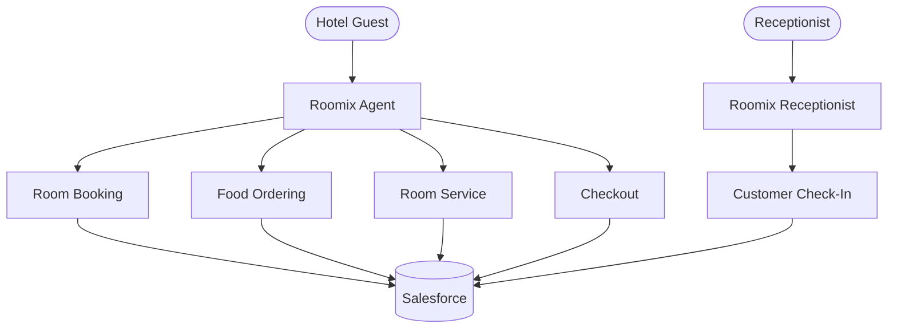

# 🏨 Roomix — AI-Powered Hotel Management with Salesforce Agentforce

<p align="center">
  
  
  
</p>

<p align="center">
  <b>Transforming hotel operations through conversational AI, intelligent automation, and specialized Salesforce Agentforce agents.</b>
</p>

---

## 🌐 Live Website

Experience the Roomix guest-facing AI assistant:

<p align="center">
  <a href="https://orgfarm-3324507aca-dev-ed.develop.my.site.com/Roomix/s">
    
  </a>
</p>

🔗 **Live Experience:** [Roomix — Guest Service Portal](https://orgfarm-3324507aca-dev-ed.develop.my.site.com/Roomix/s)

---

## 📌 About the Project

**Roomix** is a smart hotel-service solution built using Salesforce Agentforce. It uses two specialized AI agents to simplify hotel guest experiences and support front-desk operations.

Guests can interact with an AI assistant for hotel services, while receptionists use a separate agent for staff-controlled check-in operations.

## 🤖 AI Agents

### 🛎️ Roomix Agent — Guest Assistant

A customer-facing AI agent published on a website, allowing guests to interact directly through chat.

- 🛏️ Room booking
- 🍽️ Food ordering
- 🛎️ Room service requests
- 🧾 Guest checkout
- 💬 Natural-language conversations

### 🧑‍💼 Roomix Receptionist — Staff Assistant

A dedicated agent for hotel reception operations, designed to support authorized staff.

- 🧍 Customer check-in
- 📋 Guest information handling
- 🏨 Reception workflow assistance

Check-in is intentionally separated from the public guest agent so guests cannot check themselves in.

---

## ✨ Key Features

| Feature | Description |
|---|---|
| 🧠 AI-powered service | Conversational hotel assistance |
| 🛏️ Room booking | Handle room booking requests |
| 🍽️ Food ordering | Place food orders through chat |
| 🛎️ Room service | Request hotel services |
| 🧾 Checkout | Assist guests with checkout |
| 🔐 Agent separation | Distinct guest and staff responsibilities |
| 🌐 Website deployment | Public-facing guest agent experience |

## 🏗️ Architecture



## 🛠️ Technology Stack

| Technology | Usage |
|---|---|
| Salesforce | CRM and hotel data platform |
| Agentforce | AI agents and conversational experience |
| Agentforce Actions | Hotel-service operations |
| Apex | Custom business logic |
| Salesforce Flows | Workflow automation |
| Salesforce Metadata | Agent and application configuration |
| Salesforce CLI | Retrieve and deploy metadata |
| Git & GitHub | Version control |

## 📂 Project Structure

```text
Roomix-Agent/
├── force-app/
│   └── main/
│       └── default/
│           ├── bots/
│           ├── botVersions/
│           ├── genAiPlannerBundles/
│           ├── classes/
│            ├── flows/
│            ├── objects/
│            └── lwc/
├── manifest/
│   └── package.xml
├── sfdx-project.json
└── README.md
```

*Metadata folders depend on the components retrieved from the Salesforce Org.*

## 🎯 Project Goals

- Implement practical AI-powered hotel operations.
- Build specialized Agentforce agents for guests and staff.
- Automate common hotel-service workflows.
- Improve guest convenience through conversational interfaces.
- Separate guest-accessible features from staff-controlled operations.
- Maintain Salesforce metadata and development work in version control.

---

## 👨‍💻 Developer

**Rajat Kumar Jena**

Salesforce Developer | Full Stack Developer | Agentforce Enthusiast

- GitHub: [My GitHub](https://github.com/YOUR-USERNAME)
- LinkedIn: [My LinkedIn](https://www.linkedin.com/in/YOUR-LINKEDIN/)

---

<p align="center">
  ⭐ If you find this project interesting, consider giving it a star!
</p>

<p align="center">
  <b>Roomix — Making Hotel Services Smarter, One Conversation at a Time. 🏨</b>
</p>
